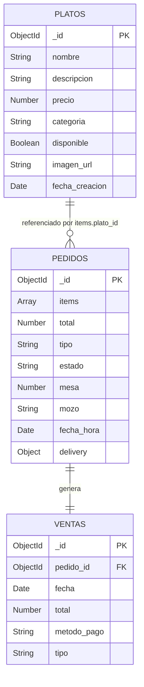

# 🗄️ Esquema de Base de Datos – MongoDB

**Base de datos:** MongoDB Atlas  
**ODM:** Mongoose  
**Tipo:** Documental (NoSQL)

---

## Diagrama de Colecciones y Relaciones (Mermaid)



> **Nota:** En MongoDB las relaciones se modelan por **referencia** (`ObjectId`) o por **embebido**.  
> Los ítems del pedido están **embebidos** dentro del documento `pedidos`.

---

## Colección: `platos`

Representa los platos del menú.

```js
{
  _id: ObjectId,                    // Clave primaria
  nombre: String,                   // requerido
  descripcion: String,
  precio: Number,                   // requerido, > 0
  categoria: String,                // "entrada" | "principal" | "bebida" | "postre"
  disponible: Boolean,              // default: true
  imagen_url: String,
  fecha_creacion: Date,             // default: Date.now
  fecha_actualizacion: Date
}
```

**Índices propuestos:**
- `categoria`
- `disponible`
- `nombre` (texto)

**Relaciones:**
- Referenciada por `pedidos.items.plato_id`

---

## Colección: `pedidos`

Documento principal del sistema. Contiene los ítems embebidos.

```js
{
  _id: ObjectId,
  items: [                          // Array embebido
    {
      plato_id: ObjectId,           // referencia a platos
      nombre: String,               // denormalizado para histórico
      cantidad: Number,             // > 0
      precio_unitario: Number,
      observaciones: String         // "sin cebolla", "bien cocido", etc.
    }
  ],
  total: Number,                    // calculado
  tipo: String,                     // "salon" | "delivery" | "para_llevar"
  estado: String,                   // "pendiente" | "en_cocina" | "listo" | "entregado" | "cancelado"
  mesa: Number,                     // solo si tipo === "salon"
  mozo: String,                     // nombre del mozo
  fecha_hora: Date,                 // default: Date.now
  delivery: {                       // solo si tipo === "delivery"
    cliente_nombre: String,
    telefono: String,
    direccion: String,
    referencias: String,
    metodo_pago: String,            // "efectivo" | "transferencia"
    repartidor: String
  },
  metodo_pago: String,              // para salón y para_llevar
  fecha_actualizacion: Date
}
```

**Índices propuestos:**
- `estado`
- `tipo`
- `fecha_hora`
- `mesa`
- `delivery.telefono`

**Relaciones:**
- `items.plato_id` → referencia a `platos`
- Referenciado por `ventas.pedido_id`

---

## Colección: `ventas`

Registro de control de caja. Se crea automáticamente al confirmar un pedido.

```js
{
  _id: ObjectId,
  pedido_id: ObjectId,              // referencia a pedidos
  fecha: Date,                      // default: Date.now
  total: Number,
  metodo_pago: String,              // "efectivo" | "transferencia"
  tipo: String                      // "salon" | "delivery" | "para_llevar"
}
```

**Índices propuestos:**
- `fecha`
- `tipo`
- `metodo_pago`
- `pedido_id` (único)

---

## Decisiones de Modelado

1. **Ítems embebidos en `pedidos`**  
   Se eligió embedding porque los ítems de un pedido no tienen sentido fuera de ese pedido y se consultan siempre juntos.

2. **Denormalización de `nombre` y `precio_unitario`**  
   Se guardan en el momento de la venta para mantener histórico aunque el plato cambie de precio o se elimine.

3. **Campo `delivery` opcional**  
   Solo se completa cuando `tipo === "delivery"`. Evita documentos innecesarios.

4. **Colección `ventas` separada**  
   Facilita reportes de caja sin recorrer todos los pedidos.

---

## Validaciones principales (Mongoose)

- `precio` y `cantidad` > 0
- `categoria`, `tipo` y `estado` con valores enumerados
- `mesa` requerida solo si `tipo === "salon"`
- `delivery` requerido solo si `tipo === "delivery"`
